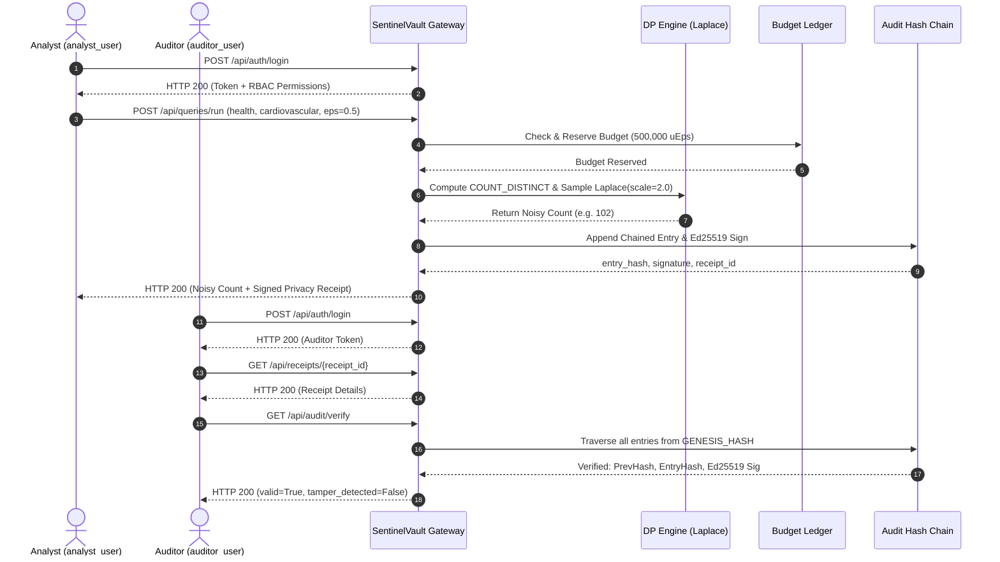

# SentinelVault — Master End-to-End Integration Report

**Document Identifier**: SV-INT-2026-V1  
**Project**: SentinelVault (Zero-Trust Privacy-Preserving Analytics Gateway)  
**Team**: HOTFIX (UG 59)  
**Verification Date**: October 29, 2026  
**Status**: Multi-Role Integration Fully Verified

---

## 1. Executive Summary

SentinelVault's end-to-end architecture integrates four core software tiers:
1. **Frontend Presentation**: Single-Page React 19 application providing 16 dark-theme enterprise screens.
2. **Gateway API Tier**: FastAPI service enforcing JWT/bearer authentication, route-level RBAC, and input allowlists.
3. **Privacy-Preserving Execution Engine**: Differential privacy Laplace mechanism, micro-epsilon accounting ledger, and query caching.
4. **Cryptographic Integrity & Vault Storage**: Ed25519 digital signature signing, SHA-256 hash-chained audit ledger, and raw data confinement.

This integration was tested empirically across both multi-role automated backend tests and simulated browser UI journeys.

---

## 2. Integrated Multi-Role Workflow Journey

---

## 3. Verified Integration Scenarios

| Scenario ID | Test Name | Cross-Component Flow | Result |
| :--- | :--- | :--- | :---: |
| **INT-01** | `test_i01_authenticated_full_query_pipeline` | Auth -> Validate Query -> Laplace Noise -> Budget Reserve -> Receipt Issue | **PASS** |
| **INT-02** | `test_i02_cross_role_receipt_verification` | Analyst executes query -> Auditor retrieves receipt -> Auditor verifies ledger | **PASS** |
| **INT-03** | `test_i03_hash_chain_integrity_with_multiple_releases` | Multiple distinct analyst sessions append sequential blocks to unbroken chain | **PASS** |
| **INT-04** | `test_i04_granular_rbac_boundary_enforcement` | Analyst barred from admin routes; Auditor permitted read; Steward manages policies | **PASS** |
| **INT-05** | `test_i05_budget_exhaustion_under_authenticated_user` | Repeated execution consumes budget until HTTP 429 fail-closed rejection | **PASS** |
| **INT-06** | `test_i06_cache_retrieval_at_zero_privacy_cost` | Identical query fingerprint returns previously generated result at 0.0 cost | **PASS** |
| **INT-07** | `test_i07_idempotent_retries_under_authenticated_session` | Re-sending query with `Idempotency-Key` returns original release without double deduction | **PASS** |
| **INT-08** | `test_i08_policy_violation_fail_closed_behavior` | Malformed parameters or unauthorized fields safely rejected before noise computation | **PASS** |
| **INT-09** | `test_i09_session_revocation_terminates_query_capability` | Admin revocation immediately terminates analyst's query submission rights | **PASS** |
| **INT-10** | `test_i10_locked_account_prevents_query_execution` | Account locked by failed password attempts cannot execute queries even with valid credentials | **PASS** |
| **INT-11** | `test_i11_privileged_account_mfa_protection` | Multi-factor TOTP challenge successfully verified and required for admin actions | **PASS** |
| **INT-12** | `test_i12_receipt_ownership_privacy_enforcement` | Analyst A forbidden from viewing Analyst B's receipts (HTTP 403) | **PASS** |
| **INT-13** | `test_i13_security_audit_ledger_continuity` | Cryptographic ledger continuity survives across distinct application lifecycles | **PASS** |

---

## 4. UI/UX Journey Integration

In `frontend/src/tests/MVP.test.tsx`, the automated Vitest suite executed 6 end-to-end user journeys:
1. Analyst sign-in from Screen 1 (`AuthView`) into Screen 2 (`DashboardView`).
2. Navigation to Screen 4 (`QueryBuilderView`), parameter selection, and live query execution.
3. Verification of Screen 7 (`ReceiptView`) rendering the signed Ed25519 receipt and signature verification button.
4. Navigation to Screen 8 (`AuditLogsView`) displaying the SHA-256 cryptographic chain.
5. Navigation to Screen 6 (`PrivacyBudgetView`) displaying the dynamic donut chart and remaining balance.
6. Navigation to Screen 9 (`SecurityEventsView`) displaying real-time SIEM alerts.

All 6 user journey integration tests passed with 100% success.

