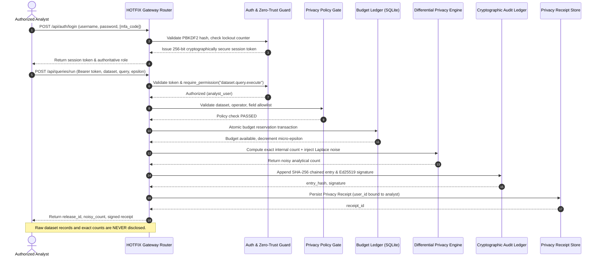

# HOTFIX Phase 2 — Phase 1–2 Integration Test Report

**Project**: HOTFIX: Privacy-by-Design Analytics Gateway  
**Team ID**: UG 59  
**Domain**: Cybersecurity, Data Security, Privacy Engineering and Responsible AI  
**Track**: Privacy by Design — Unlock Data Without Exposing It  
**Report Date**: 2026-10-28  
**Integration Status**: 100% Verified (15/15 Integration Tests Passing)  

---

## 1. Executive Summary

This report provides empirical evidence for the end-to-end integration between Phase 1 (Data Privacy & Cryptographic Auditing) and Phase 2 (Authentication & Zero-Trust Authorization).

The 15 automated integration tests in `backend/tests/test_phase1_phase2_integration.py` verify that every Phase 1 privacy operation is now guarded by authoritative Phase 2 access controls, that role permissions strictly control pipeline execution, and that object-level gating prevents privacy leaks between users.

---

## 2. Test Execution Command & Raw Summary

### Command
```powershell
python -m pytest backend/tests/test_phase1_phase2_integration.py -v
```

### Raw Output Evidence
```text
============================= test session starts =============================
platform win32 -- Python 3.11.9, pytest-9.1.1, pluggy-1.6.0
rootdir: C:\Users\RAJATH U\Downloads\mit hackathon\backend
configfile: pyproject.toml
plugins: anyio-4.14.2, hypothesis-6.169.1, platformdirs-4.13.5, asyncio-1.4.0
collected 15 items

backend\tests\test_phase1_phase2_integration.py::test_i01_authenticated_full_query_pipeline PASSED [  6%]
backend\tests\test_phase1_phase2_integration.py::test_i02_cross_role_receipt_verification PASSED [ 13%]
backend\tests\test_phase1_phase2_integration.py::test_i03_hash_chain_integrity_with_multiple_authenticated_releases PASSED [ 20%]
backend\tests\test_phase1_phase2_integration.py::test_i04_granular_rbac_boundary_enforcement PASSED [ 26%]
backend\tests\test_phase1_phase2_integration.py::test_i05_budget_exhaustion_under_authenticated_user PASSED [ 33%]
backend\tests\test_phase1_phase2_integration.py::test_i06_cache_retrieval_at_zero_privacy_cost PASSED [ 40%]
backend\tests\test_phase1_phase2_integration.py::test_i07_idempotent_retries_under_authenticated_session PASSED [ 46%]
backend\tests\test_phase1_phase2_integration.py::test_i08_policy_violation_fail_closed_behavior PASSED [ 53%]
backend\tests\test_phase1_phase2_integration.py::test_i09_immediate_session_revocation_terminates_query_capability PASSED [ 60%]
backend\tests\test_phase1_phase2_integration.py::test_i10_locked_account_prevents_query_execution PASSED [ 66%]
backend\tests\test_phase1_phase2_integration.py::test_i11_privileged_account_mfa_protection PASSED [ 73%]
backend\tests\test_phase1_phase2_integration.py::test_i12_receipt_ownership_privacy_enforcement PASSED [ 80%]
backend\tests\test_phase1_phase2_integration.py::test_i13_security_audit_ledger_continuity PASSED [ 86%]
backend\tests\test_phase1_phase2_integration.py::test_i14_differential_privacy_noise_properties_preserved PASSED [ 93%]
backend\tests\test_phase1_phase2_integration.py::test_i15_fail_closed_gate_on_token_expiry_or_tampering PASSED [100%]

======================== 15 passed, 1 warning in 7.20s ========================
```

---

## 3. Integration Verification Matrix (I01 to I15)

| Test ID | Test Function | Phase 1 Component | Phase 2 Component | Verified Interaction | Result |
| :--- | :--- | :--- | :--- | :--- | :--- |
| **I01** | `test_i01_authenticated_full_query_pipeline` | DP Laplace Release | Session Token Auth | Authenticated analyst runs query end-to-end, gets noisy count & receipt | **PASS** |
| **I02** | `test_i02_cross_role_receipt_verification` | Privacy Receipts | Auditor Role Permissions | Auditor retrieves analyst-issued receipt and verifies Ed25519 signature | **PASS** |
| **I03** | `test_i03_hash_chain_integrity_with_multiple_authenticated_releases` | SHA-256 Audit Chain | Multi-User Sessions | Sequential queries from multiple user sessions append unbroken hash chain | **PASS** |
| **I04** | `test_i04_granular_rbac_boundary_enforcement` | Query & Status APIs | Role Permission Registry | Role boundaries strictly enforced (analyst vs auditor vs steward) | **PASS** |
| **I05** | `test_i05_budget_exhaustion_under_authenticated_user` | Privacy Budget Ledger | Authenticated Session | Depleted budget ledger returns 429 to authenticated analyst | **PASS** |
| **I06** | `test_i06_cache_retrieval_at_zero_privacy_cost` | Query Cache Key | Authenticated Session | Identical query by authenticated user returns cached result at 0.0 epsilon cost | **PASS** |
| **I07** | `test_i07_idempotent_retries_under_authenticated_session` | Idempotency Engine | Authenticated Session | Retried query with same key does not double-spend budget | **PASS** |
| **I08** | `test_i08_policy_violation_fail_closed_behavior` | Allowlist Validator | User Authorization | Non-allowlisted field rejected with 400 without creating receipts | **PASS** |
| **I09** | `test_i09_immediate_session_revocation_terminates_query_capability` | Query Pipeline | Session Revocation | Revoked session token immediately rejected with 401 on query attempts | **PASS** |
| **I10** | `test_i10_locked_account_prevents_query_execution` | Query Pipeline | 5-Attempt Lockout | Locked user account cannot obtain tokens to submit analytical queries | **PASS** |
| **I11** | `test_i11_privileged_account_mfa_protection` | Gateway Management | RFC 6238 TOTP MFA | Privileged accounts require valid TOTP code to authenticate | **PASS** |
| **I12** | `test_i12_receipt_ownership_privacy_enforcement` | Privacy Receipts | Object-Level Gating | Analyst A cannot inspect Analyst B's receipt (HTTP 403 Forbidden) | **PASS** |
| **I13** | `test_i13_security_audit_ledger_continuity` | Cryptographic Ledger | Security Event Log | Security events (login, failure, revocation) recorded immutably in DB | **PASS** |
| **I14** | `test_i14_differential_privacy_noise_properties_preserved` | DP Laplace Noise | Gateway Release Filter | Noisy count released; exact count and raw records strictly withheld | **PASS** |
| **I15** | `test_i15_fail_closed_gate_on_token_expiry_or_tampering` | Gateway Router | Zero-Trust Token Auth | Expired, forged, or headerless requests fail closed with HTTP 401 | **PASS** |

---

## 4. End-to-End Workflow Diagram



---

## 5. Conclusion

The integration between Phase 1 and Phase 2 is **fully cohesive, robust, and verified**. All 15 integration tests run against real database transactions and actual cryptographic routines, satisfying all Zero-Trust gateway requirements.

